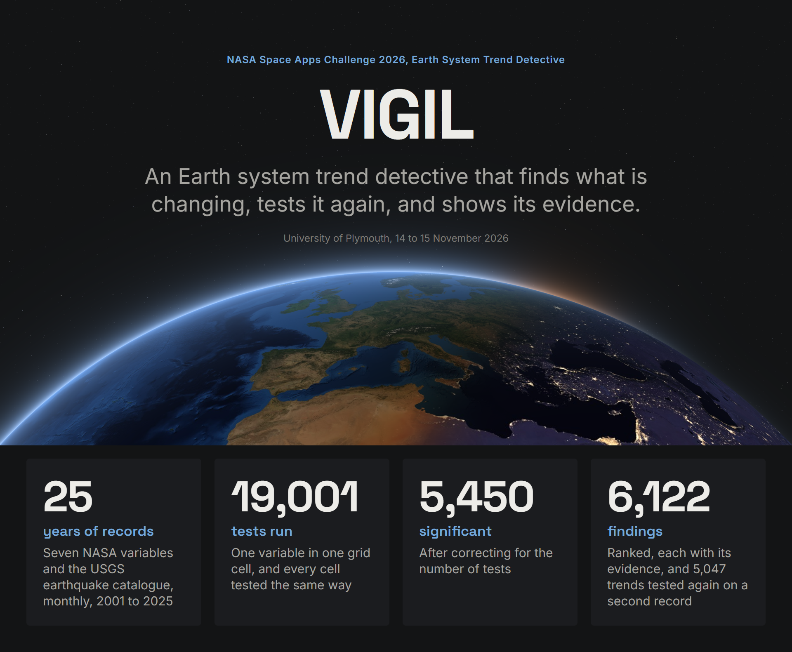

Open it in a browser at [keepvigil.earth](https://keepvigil.earth), or [download the Windows app](https://keepvigil.earth/download/VIGIL-win-x64.zip).

# VIGIL

VIGIL (Visualising & Identifying Global Indicators of Long-term change) is the University of Plymouth Hackathon Team's entry for the 2026 NASA Space Apps Challenge, under the challenge [Be An Earth System Trend Detective!](https://www.spaceappschallenge.org/2026/challenges/earth-system-trend-detective/).

## The challenge

The brief asks for a tool that lets someone pick variables measured by Earth science missions or produced by Earth science models, see how they change over time, and work out:

- what is changing
- where it is changing
- how much it is changing
- whether the change is statistically significant

A variable can trend one way in one region and the opposite way in another, even when one process drives both, so the "where" matters as much as the "what".

## What VIGIL does

VIGIL scans the whole planet for change without being told where to look. It divides the Earth into 2.5° grid cells, tests every cell the same way, corrects for the number of tests it ran, and ranks what it finds. Then it tests each trend again on a second record of the same variable, where one exists, and says on the finding how that went.

A desktop app shows the results on a globe. Each finding opens into its evidence: the series, the trend with its uncertainty, the method, the sources and what the finding cannot say. You can draw any region on the globe and get its trends worked out on the spot, and ask the AI Detective questions that it answers only from the findings. A web viewer at [keepvigil.earth](https://keepvigil.earth) shows the same results in a browser.

The globe can stand the layer up as columns, so the size of a change reads as height, and play any variable year by year from 2001 to 2025. A presenter can have the audience's phones follow their screen. Every finding exports as CSV and GeoJSON for QGIS or a notebook, and links to its cell in NASA Worldview.

The scan covers January 2001 to December 2025 and reads eight variables:

| Variable | Source |
|---|---|
| Air temperature at 2 m | NASA MERRA-2 |
| Precipitation | NASA GPM IMERG |
| Soil moisture, 0 to 10 cm | NASA GLDAS Noah |
| Vegetation (NDVI) | NASA Terra MODIS |
| Snow cover | NASA Terra MODIS |
| Sea surface temperature | NASA Aqua MODIS |
| Chlorophyll-a at the sea surface | NASA Aqua MODIS |
| Earthquakes of magnitude 4.5 and above | USGS catalogue |

Trends are re-tested on a second product for five of them: GISTEMP for both temperatures, GPCP for precipitation, MERRA-2's land model for soil moisture and Aqua MODIS for vegetation. `docs/brief/Project_Brief.pdf` has the plan the weekend followed, and `python/vigil/pipeline/README.md` has every product and how it was read.

## Status

The build happened over the hackathon weekend, 14 and 15 November 2026.

Before the event we built the desktop app's shell: the project structure, the splash screen, the theme, a set of interface controls and an interactive 3D globe. We also wrote the planning documents in this repository. At that point the app held no Earth-observation data and ran no analysis, and everything it showed was demo data.

The data pipeline, the analysis, the service, the AI Detective, the web viewer and every screen that presents results were built during the event. AI coding assistants wrote much of the code under our direction and review. No statistic in VIGIL is computed by a language model.

## Running it

You need Windows, the .NET 8 SDK (Visual Studio 2022 works too) and Python 3.12.

**The analysis service.** From `python/`:

```
py -3.12 -m venv .venv
.venv\Scripts\python -m pip install -r requirements.txt
$env:VIGIL_SNAPSHOT = "..\data\scan\snapshot.json"
$env:VIGIL_SCAN_DATA = "..\data\scan\scan-data.npz"
.venv\Scripts\python -m uvicorn vigil.api.app:app --port 8000
```

Once the environment exists, `python\start-service.cmd` does the last three lines in one go. It finds the scan in `data\scan`, reads the Detective's key, and starts the service again if it stops. Add `-Network` where the line above would take `--host 0.0.0.0`.

The service also serves the web viewer, at `http://127.0.0.1:8000/`, showing the scan it holds. Add `--host 0.0.0.0` to let other devices on the network open it, which is what the desktop app's Present button needs.

`VIGIL_SNAPSHOT` is the stored scan and `VIGIL_SCAN_DATA` the gridded data it was made from. Neither is in the repository: `python/vigil/pipeline/README.md` says how to make them. With neither set, the service serves the contract's fixture, which is made up and says so. The Detective also needs `ANTHROPIC_API_KEY` in that terminal. A key set with `$env:` is gone when the terminal closes: `setx ANTHROPIC_API_KEY "the key"` saves it for your user, and `start-service.cmd` reads it from there. `python/vigil/api/README.md` lists every setting and call.

**The desktop app.** With no service running on the machine it uses the public one behind keepvigil.earth, so the download from the site works by itself. To use your own, start the app after the service:

```
cd VIGIL
dotnet build
dotnet run --project VIGIL
```

Or open `VIGIL/VIGIL.sln` in Visual Studio and press F5.

After the splash screen the app opens on the Overview page with the scan the service holds. If the service is not running it looks for a `snapshot.json` beside the exe, which the download from the site carries, and failing that it falls back on the fixture built into it, when every page that lists results carries a "Synthetic fixture" badge. Zones' trends, the years, "Recompute", presenting and the Detective need the service whichever scan is on screen.

**The web viewer.** Any plain web server pointed at a checkout serves the built copy at the root (`index.html` and `viewer/`). To work on it: `cd web`, `npm install`, `npm run dev`.

`docs/submission/demo-script.md` walks through the app screen by screen.

## Layout

```
├── README.md            this file
├── AGENTS.md            how to write code here, for people and coding agents
├── COORDINATION.md      who works in which part of the repository
├── CLAUDE.md            points Claude Code at the two files above
├── contract/            the result format, its checker and the fixture file
├── python/vigil/
│   ├── pipeline/        downloads NASA products and puts them on the scan grid
│   ├── analysis/        trends, significance, change points, cascades, contradictions, ranking
│   ├── api/             the service, the scan-to-document step, zones and the re-test
│   └── detective/       the AI Detective: tool calls and the check on its answers
├── web/                 the web viewer's source (React, TypeScript, Vite)
├── index.html, viewer/  the built web viewer
├── infra/               cloud setup
├── docs/brief/          the plan for the weekend: Project_Brief.pdf and the HTML it is printed from
├── docs/submission/     demo script, video and written project page
├── assets/              NASA Blue Marble and Black Marble imagery, satellite pictures, the team logo
└── VIGIL/
    ├── VIGIL.sln
    └── VIGIL/           the WinForms project (.NET 8)
        ├── Program.cs       entry point: loader first, then main window
        ├── Theming/         colours, fonts, icons, drawing helpers, dark title bar
        ├── Controls/        custom-drawn controls, with the globe, chat, zones and evidence in folders of their own
        ├── Forms/           LoaderForm (splash), MainForm (app shell), VigilForm (base)
        ├── Pages/           Overview, Evidence, Map, Detective and the Components gallery
        ├── Data/            the clients for the service, and the saved chats and zones
        ├── Models/          plain types that mirror the result contract
        └── VIGIL.csproj
```

## Working on it

Read `AGENTS.md` and `COORDINATION.md` before changing anything. The first covers how the code is written. The second covers which parts are yours to edit, so that several people and their coding agents can work at once without overwriting each other.
